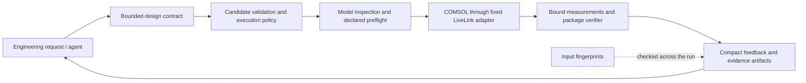

# COMSOL MCP Verifier

**Verification-first simulation workflows for coding agents.**

COMSOL MCP Verifier connects engineering intent to bounded COMSOL runs and inspectable
evidence. A Python service validates candidates against a design contract,
checks execution policy, drives a fixed MATLAB LiveLink adapter, and returns
deterministic verifier feedback with provenance and artifact paths.

A model that solves can still have the wrong excitation, evaluate the wrong
dataset, or reuse an old solution. Giving an agent the raw solver API does not
resolve those problems. This project makes the contract, observed model facts,
result bindings, and verification evidence explicit. Physical validity still
depends on the model and its package-owned checks.

A successful MCP call is not necessarily a successful solver run, a correctly
configured simulation, a fresh solution, or a physically validated result. Each
claim needs its own evidence.

This is the canonical repository for future development of the generic core.
The internal Python package remains `em_design_mcp` for compatibility.



The generic core lives here. Production models, builders, physical assumptions,
parameter ranges, objectives, calibration data, parsers, and verifiers live in
**external design packages**. Adding a model normally requires no core changes.

## Engineering capabilities

| Mechanism | What it contributes |
|---|---|
| Bounded contracts | Candidate fields, numeric bounds, compatibility checks, trusted model bindings, and declared sweep limits |
| Selective model inspection | Requested excitation, periodic, material, selection, mesh, study/solution/dataset, and output facts |
| Deterministic preflight | Small checks against actual facts; unsupported checks and unavailable required facts fail explicitly |
| Named measurements | Package-owned expressions bound to study, solution, dataset, unit, selection, and optional normalization |
| Provenance | Content fingerprints of the model, active contracts, adapters, plugins, and declared evidence; changed inputs reject stale reuse |
| Persistent local jobs | Independent worker subprocesses, disk-backed state, non-blocking revision-aware waits, one solve at a time per local COMSOL server, retained failures, and compact results |
| Verifier feedback | Package-defined metrics, margins, limiting constraints, and explanations for the next engineering decision |

There is no MCP tool for arbitrary MATLAB, Java, Python, shell, or COMSOL commands.
Packages are nevertheless **trusted executable inputs**: their Python plugins run
locally and their bindings control model operations. This is not a sandbox for
untrusted packages or a multi-tenant service.

## Try it without COMSOL

Use **Python 3.10+** and a source checkout with an editable installation. Keep the
checkout in place: the current runtime locates MATLAB adapters and fingerprints
relative to it. Standalone wheel installation is not supported yet.

```sh
git clone https://github.com/yushi-zhou/comsol-mcp-verifier.git
cd comsol-mcp-verifier
python -m venv .venv
```

Activate the environment with `source .venv/bin/activate` on POSIX, or
`.\.venv\Scripts\Activate.ps1` in PowerShell, then:

```sh
python -m pip install -e ".[test]"
python -m pytest -q
```

The default tests use synthetic fixtures, not commercial solver software. To run
one complete mock evaluation, select the included fixture package:

```sh
# POSIX, from the checkout root
export EM_DESIGN_PACKAGE_ROOTS="$PWD/tests/fixtures/designs"
export EM_DESIGN_MCP_RUNS_DIR="$PWD/runs/mock-demo"
```

```powershell
# PowerShell, from the checkout root
$env:EM_DESIGN_PACKAGE_ROOTS = (Resolve-Path tests/fixtures/designs).Path
$env:EM_DESIGN_MCP_RUNS_DIR = Join-Path (Get-Location).Path "runs/mock-demo"
```

Then, in either shell:

```sh
python -m em_design_mcp.cli run-json --input tests/fixtures/mock-request.json --output runs/mock-demo/response.json --pretty
```

Expect `schema_version: "em_design_mcp_cli_v1"`, `ok: true`, and
`result.status: "evaluated"`. Inspect `result.overall_pass` separately from the
CLI envelope. The synthetic verifier exercises plumbing; its scores are not EM
predictions or benchmark results. Generated evidence stays under `runs/`.

## Use from an MCP client

Launch the STDIO server with the installed environment's Python:

```sh
python -m em_design_mcp.server
```

Configure your client to use that interpreter and the checkout as its working
directory. A generic client configuration is:

```json
{
  "mcpServers": {
    "comsol": {
      "command": "/absolute/path/to/comsol-mcp-verifier/.venv/bin/python",
      "args": ["-m", "em_design_mcp.server"],
      "env": {"EM_DESIGN_PACKAGE_ROOTS": "/absolute/path/to/design-packages"}
    }
  }
}
```

On Windows, use the checkout's `.venv/Scripts/python.exe`. These are placeholders,
not required directory names. The optional [EM simulation skill](.codex/skills/em-simulation/SKILL.md)
describes the same workflow for coding agents.

| Public tool | Role |
|---|---|
| `discover_designs` | Find packages and compatible problems |
| `inspect_contract` | Read allowed candidates, outputs, verifier, and provenance |
| `inspect_model` | Read selected actual facts and optional named measurements; requires LiveLink |
| `prepare_run` | Check a candidate and declared cost limits without launching COMSOL |
| `start_run` | Validate again, start a worker, and wait for an initial result |
| `get_run` | Wait for a revision change or read retained evidence |
| `cancel_run` | Request best-effort termination of the recorded worker process tree |

Discover and inspect once; pass the returned provenance ID to `start_run`. If the
job is still running, use `get_run` with its revision and a server-side wait
(maximum 55 seconds per call). Full arrays require `include_result=true`; normal
responses provide bounded summaries and local artifact paths. With fixture
profiles, explicitly select `backend="mock"`.

The synchronous [JSON CLI](docs/INSTALLATION.md#json-cli-compatibility) remains
available for harnesses and keeps the `em_design_mcp_cli_v1` envelope.

## Connect real models

**COMSOL version compatibility:** COMSOL MCP Verifier targets COMSOL Multiphysics
6.0 and later. The core workflow was developed on COMSOL 6.0 and end-to-end
smoke-tested on COMSOL Multiphysics 6.4 Build 429 with MATLAB R2026a.
Version-specific installation paths and model-authoring APIs may differ between
releases.

**MCP workflow smoke-tested on COMSOL 6.4.** This does not establish a complete
compatibility matrix across physics modules or COMSOL APIs. See the
[smoke-test evidence and scope](docs/TESTING.md#comsol-64-workflow-evidence).

Real execution and inspection require MATLAB, COMSOL Multiphysics with LiveLink
for MATLAB, the model's required modules/licenses, a running COMSOL server, and a
trusted external package. None of those commercial assets are distributed here.

Copy `.env.example` to `.env`, configure runtime paths, and register package roots.
See [installation and LiveLink setup](docs/INSTALLATION.md) and the
[design package guide](docs/DESIGN_PACKAGES.md). Package discovery defaults to the
sibling directory `../em_design_modals`; `EM_DESIGN_PACKAGE_ROOTS` overrides it.

## Evidence and limits

The [test guide](docs/TESTING.md) distinguishes Python tests, mocked adapter tests,
MATLAB source checks, and reported real solver evidence. Public CI runs only the
COMSOL-free suite and mock example. This source release includes no real COMSOL
model or solver example package; reproducible physics regressions belong to
external design packages.

- Preflight checks declared expectations. It does not establish Maxwell-equation
  correctness, convergence, suitable boundary conditions, or valid normalization.
- Saved model identity does not establish solution freshness. Execution receipts
  cover only the named measurement solutions explicitly recomputed by a run;
  arbitrary saved solutions and legacy table-only outputs remain unverified.
- Candidate validation supports a documented schema subset and rejects keywords
  it cannot enforce. Real runs need an explicit `allow_real_backend: true`. Cost
  gates use declared sweep counts, not predictions of memory or solve time.
- Jobs are local subprocesses with retained files, not checkpoint/restart or
  scheduling infrastructure beyond a per-server queue. Cancellation cannot
  guarantee interruption of work already running on a separately hosted COMSOL
  server.
- Source installation and trusted local use are the supported deployment model.
  Version support is a workflow target, not universal COMSOL API/module coverage.

Read [architecture and trust boundaries](docs/ARCHITECTURE.md) and
[model observation, preflight, and freshness](docs/MODEL_OBSERVATION.md) for the
precise guarantees and limitations.

## Development and publication

See [contributing](CONTRIBUTING.md) for scope, checks, and review expectations, and
the [publication checklist](docs/PUBLICATION.md) for release prerequisites.

This repository's source code and documentation are licensed under the
[MIT License](LICENSE), copyright 2026 yushi-zhou. This grant does not cover
COMSOL Multiphysics, MATLAB, other third-party software, external MPH files,
private design packages, or third-party datasets. Those have their own terms.
This project is not affiliated with COMSOL or MathWorks.
